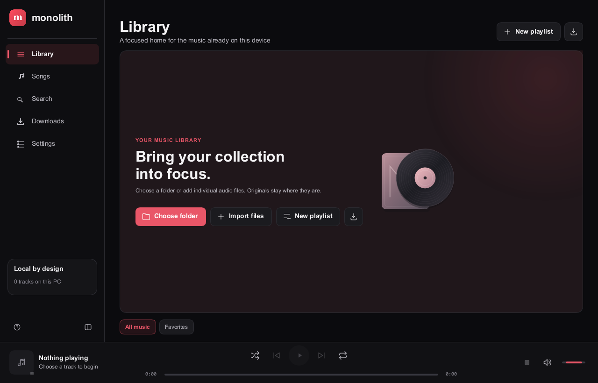
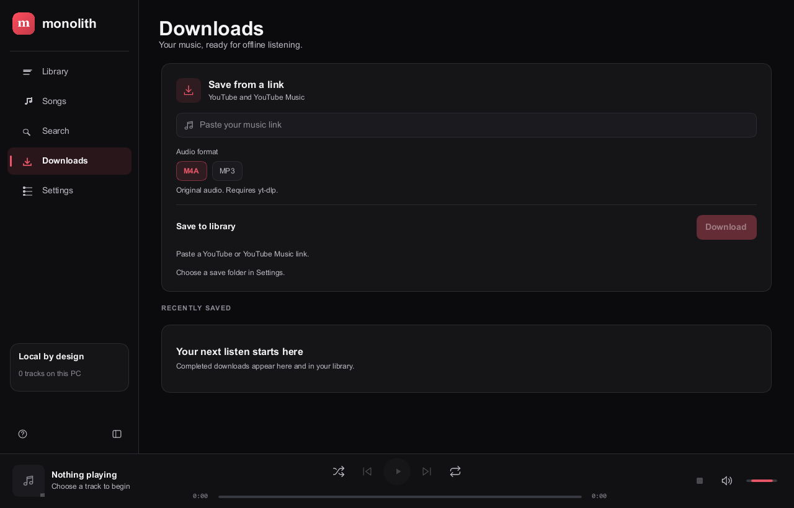
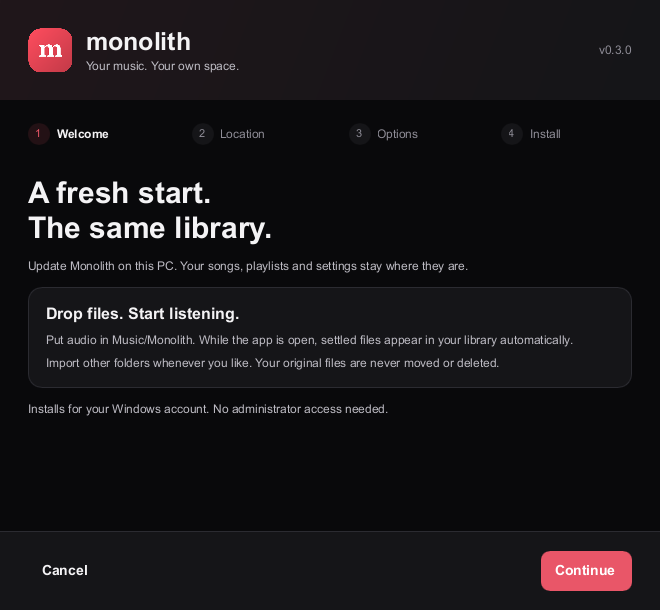
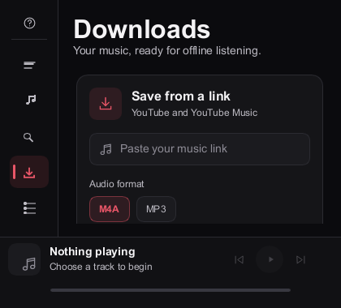
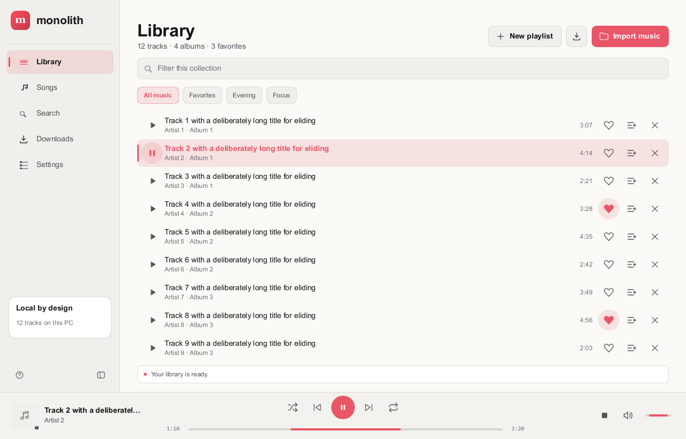
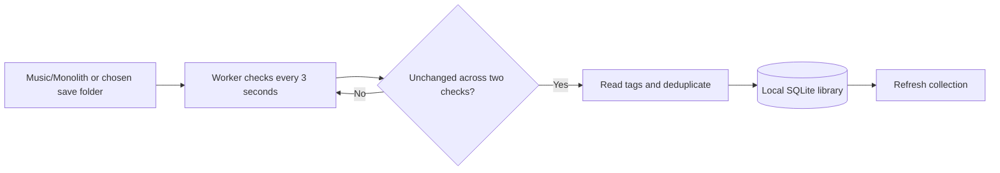
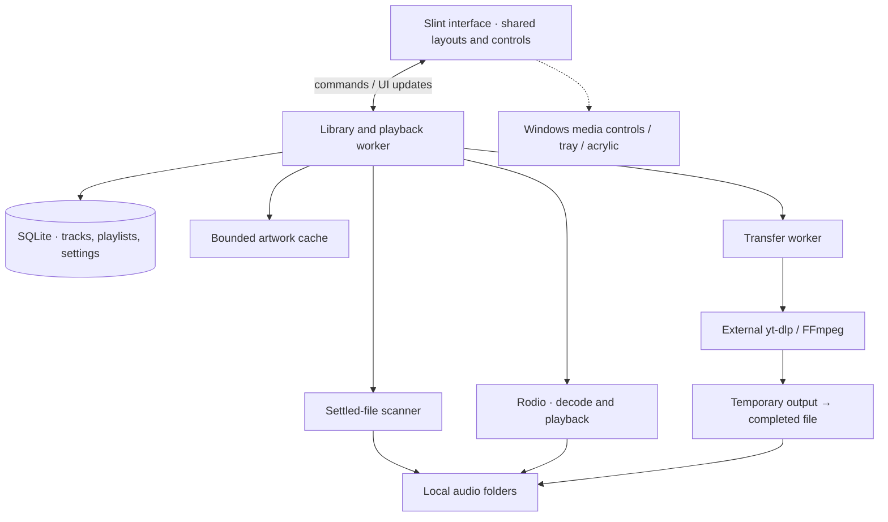

<p align="center">
  
</p>
<h1 align="center">Monolith Desktop</h1>
<p align="center"><strong>Your music. A place of its own.</strong><br>Native local playback, a personal library, and a quiet coral interface.</p>
<p align="center">
  
  
  
  
</p>
<p align="center">
  <a href="#preview">Preview</a> · <a href="#your-library">Features</a> ·
  <a href="#install">Install</a> · <a href="#architecture">Architecture</a> ·
  <a href="#build-and-check">Build</a> · <a href="https://github.com/naveed-gung/Monolith">Mobile app ↗</a>
</p>

<p align="center"></p>

Monolith plays audio from your own files. Importing indexes their paths and metadata;
it does not move or modify the originals. Favorites, playlists and playback settings
live locally in SQLite. No account, cloud sync, or telemetry service.

## Preview

| Downloads | Windows setup |
| --- | --- |
|  |  |

<details>
<summary><strong>Compact windows and light appearance</strong></summary>

| Compact navigation | Light appearance |
| --- | --- |
|  |  |

</details>

These are captures of the rendered Windows interface. Populated screenshots use
explicit test fixtures to demonstrate long titles and populated layouts; they
are not evidence of audio playback. Linux appearance has not been captured yet.

## Your library

| Feature | What you get |
| --- | --- |
| **Automatic imports** | New audio in Music/Monolith and your selected save folder appears while the app is open. Nested folders work too. |
| **Library and playlists** | Favorites, custom playlists, and M3U/PLS imports. Removing a library entry leaves the original file alone. |
| **Songs and search** | Sort by title, artist, album or added order. Local search responds after a short typing debounce. |
| **Playback** | Seek, volume, shuffle and repeat, plus a compact bar and expanded player. |
| **Downloads** | Explicit transfers through a user-selected yt-dlp executable. Real progress, cancellation and history; tools are not bundled. |
| **Appearance** | Dark, light and system modes, animated icons, visible keyboard focus and adaptive navigation. Windows motion preference is respected. |
| **Windows integration** | Media controls, tray support, optional acrylic, and a per-user installer. |

### Drop a file in. Keep listening.



New copies normally appear after 3–6 seconds, once copying settles. Files added
while Monolith was closed are found after opening it. An unchanged file you
intentionally removed from the library stays removed across restarts; use manual
import to bring it back. Other folders remain available through the import picker.

## Install

### Windows

Build `monolith-setup.exe` using the commands below, then run it. Setup lets you
choose a destination, shortcuts and whether to open the app afterwards. It installs
for the current user and registers an uninstaller; administrator rights are not
needed for the default location. An update preserves the library database.

```powershell
.\monolith-setup.exe /S --no-launch
```

This repository contains source, not executable build caches. A GitHub source
archive is not an installer. Release packages, when published, belong in Releases.

### Linux

The interface, playback worker and automatic imports share the same source as
Windows. Linux packaging supports a per-user install and a Debian package built
from a native Linux executable.

**Linux compilation and `.deb` installation are still unverified.** Windows media
keys/tray and acrylic do not imply Linux support for those features. See the
[Linux build and packaging guide](packaging/linux/README.md) for dependencies,
portal dialogs, package generation and platform differences.

### Optional download tools

Select your installed yt-dlp executable in Settings. YouTube extraction can also
require a supported JavaScript runtime and yt-dlp EJS support. MP3 conversion needs
FFmpeg on `PATH`. Tools are external and are not installed automatically. Save only
content you own or have permission to download.

## Architecture



Filesystem work and metadata parsing run off the UI thread. Transfers use argument
arrays, bounded output handling, staging files and collision-safe publication.
Artwork decoding and caching are bounded. The Linux build uses desktop portal file
dialogs; Windows integration is conditionally compiled.

## Build and check

Requires a Rust toolchain compatible with the locked dependencies. Windows also
needs the Visual Studio C++ build tools and Windows SDK. Linux system packages are
listed in its [packaging guide](packaging/linux/README.md).

```sh
cargo build --release --locked --bin monolith-desktop
cargo test --release --locked --lib
cargo run --release --locked --example workflow_check
cargo run --release --locked --example transfer_check
cargo run --release --locked --example visual_check -- shot.ppm 1280 820 0 check
```

`workflow_check` needs a display and audio device. `transfer_check` runs a fake
helper without network traffic. Add `--offline` once the dependencies are cached.

Build the Windows installer from PowerShell, reusing the player already built:

```powershell
$env:MONOLITH_PLAYER_EXE = (Resolve-Path target/release/monolith-desktop.exe).Path
cargo build --manifest-path installer/Cargo.toml --release --locked --offline
# installer/target/release/monolith-setup.exe
```

The installer also builds the player when the override is absent, using the main
`target` directory rather than creating a duplicate player cache.

### Storage and verification

Rust build caches are much larger than the shipped application. `target/` and
`installer/target/` are generated and ignored by Git, as are local captures and
`dist/`. Building debug and release profiles keeps separate artifacts. Retain
release packages before cleaning caches; dependency sources remain in Cargo's
separate cache.

Windows verification includes 23 library tests, playback/persistence workflows,
transfer handling, live folder detection and pointer/keyboard checks. Screenshots
cover compact and wide layouts; glyph checks exercise software and GPU renderers.
The previous installed build measured 49.8 MiB **idle** working set. This is not a
playback peak or a guarantee; the normal-playback target remains ≤130 MB including
child processes.

Physical DPI transitions, screen-reader announcements, large-library performance,
real download peaks and Linux runtime still need verification. See the examples
for executable checks rather than treating screenshots as full feature coverage.

## One identity, two apps

| Desktop | Mobile |
| --- | --- |
| **This repository** · Rust + Slint, Windows verified; Linux build pending | **[Monolith](https://github.com/naveed-gung/Monolith)** · Flutter for Android and iOS |
| Local file paths and SQLite | Mobile imports, local storage and platform audio integration |

They share the Monolith visual identity, but have independent codebases and
libraries. Cross-device sync is not implemented.

## Project assets and licence

The developer credit is part of the product. Its generated identity and portrait
payloads are required build inputs; obfuscation is not encryption. Original source
portraits and private working transcripts are not needed to build the app.

Proprietary licence — see [LICENSE](LICENSE). Built with [Slint](https://slint.dev),
[Rodio](https://github.com/RustAudio/rodio), [rusqlite](https://github.com/rusqlite/rusqlite)
and [Lofty](https://github.com/Serial-ATA/lofty-rs).
