<p align="center">
  
</p>
<h1 align="center">Monolith Desktop</h1>

> [!NOTE]
> **Development on hold**
>
> Monolith Desktop is currently on hold. New features and improvements are planned for a future update.

<p align="center"><strong>Your music. A place of its own.</strong><br>Native local playback, a personal library, and a quiet coral interface.</p>
<p align="center">
  
  
  
  
</p>
<p align="center">
  <a href="#preview">Preview</a> · <a href="#your-library">Features</a> ·
  <a href="#install">Install</a> · <a href="#architecture">Architecture</a> ·
  <a href="#build-and-check">Build</a> · <a href="https://github.com/naveed-gung/Monolith">Mobile app ↗</a>
</p>

<p align="center"></p>

Monolith plays audio from your own files. Importing indexes their paths and metadata;
it does not move or modify the originals. Favorites, playlists and playback settings
live locally in SQLite. No account, cloud sync, or telemetry service.

## Preview

| Downloads | Windows setup |
| --- | --- |
|  |  |

| Select several songs | Sharing explained in place |
| --- | --- |
| 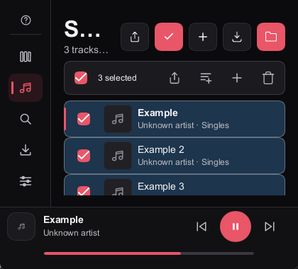 | 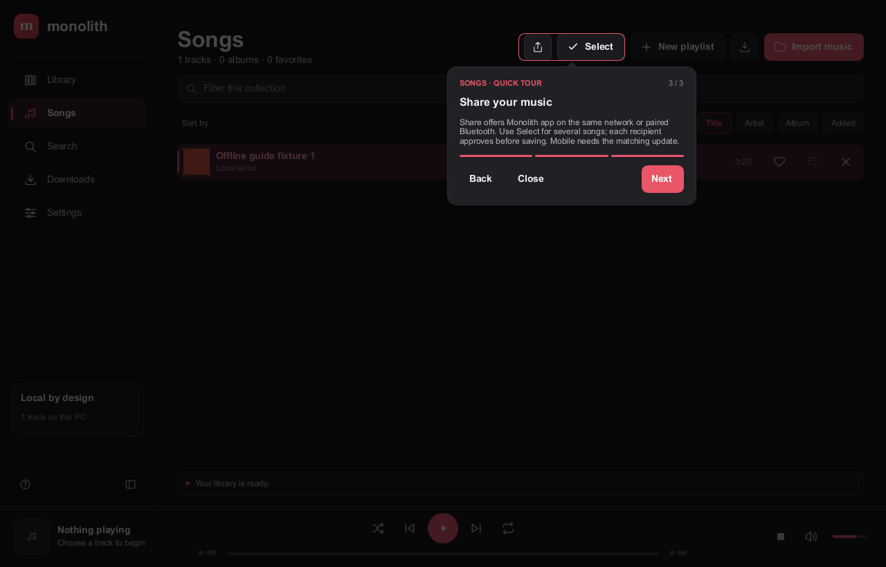 |

<details>
<summary><strong>Search, compact windows and light appearance</strong></summary>

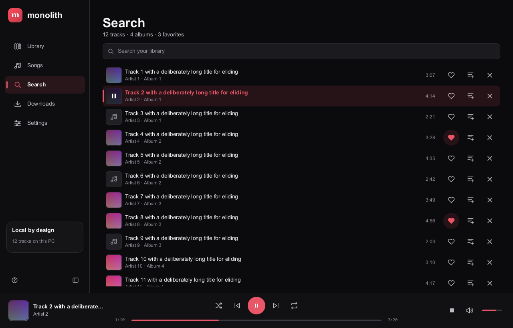

| Compact navigation | Light appearance |
| --- | --- |
|  |  |

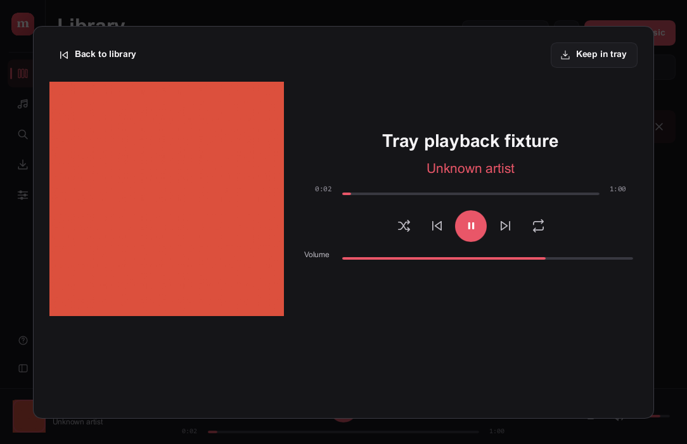

| Learn the controls in place | Remove with confidence |
| --- | --- |
| 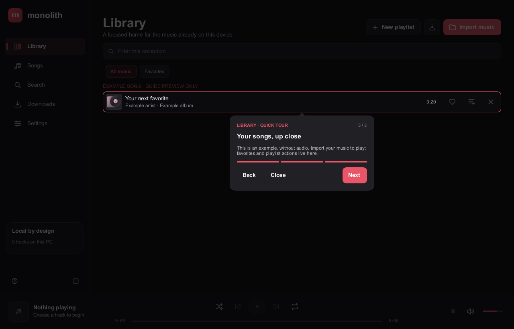 | 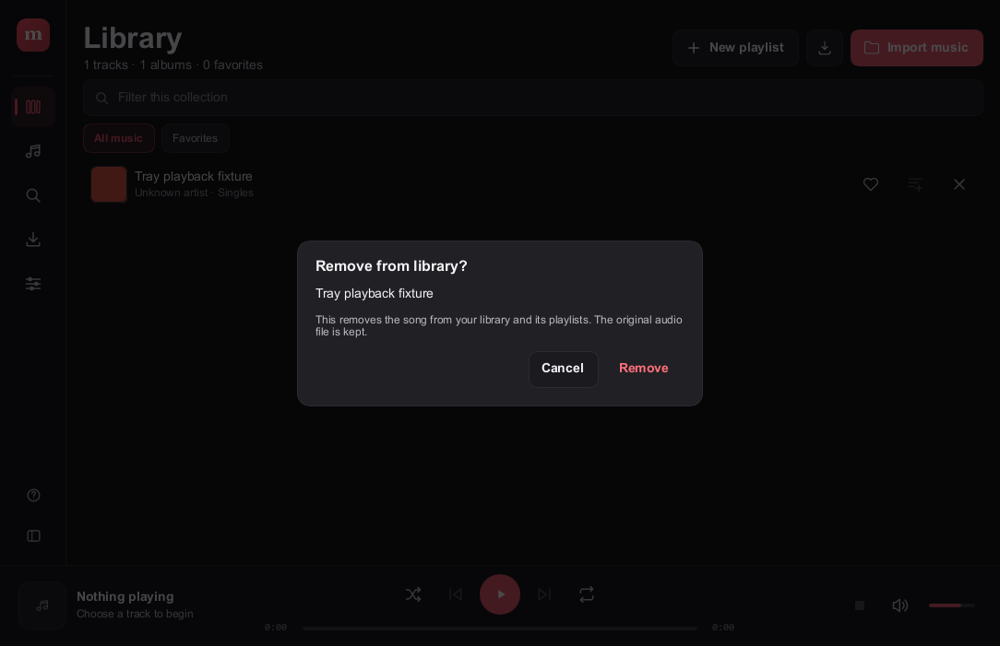 |

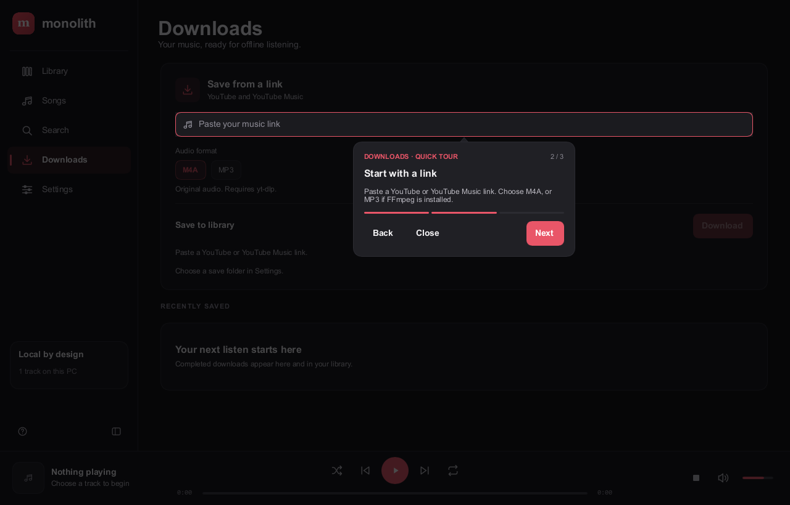

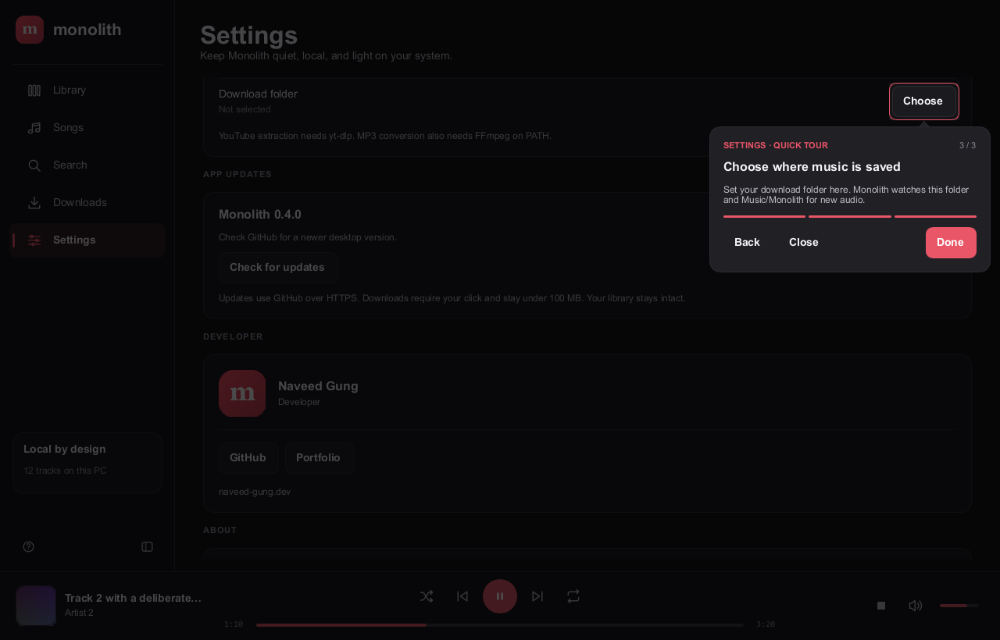

</details>

These are captures of the rendered Windows interface. Populated screenshots use
explicit test fixtures to demonstrate long titles and populated layouts; they
are not evidence of audio playback. Linux appearance has not been captured yet.

## Your library

| Feature | What you get |
| --- | --- |
| **Automatic imports** | New audio in Music/Monolith and your selected save folder appears while the app is open. Nested folders work too. |
| **Library and playlists** | Favorites, custom playlists, and M3U/PLS imports. Song removal asks for confirmation, defaults to Cancel, and leaves the original audio file alone. Removing from a playlist keeps the song in Library. |
| **Songs and search** | Sort by title, artist, album or added order. Local search responds after a short typing debounce. |
| **Selection and sharing** | Select songs with checkboxes, then share a batch, add to a playlist, create a populated playlist or remove entries after confirmation. Library and Songs offer a Share icon with Monolith app and Bluetooth options. |
| **Playback** | Click a song's artwork, title, details or row to play/pause. Favorites and playlist actions stay separate. Click the player’s song name or artwork to expand it. Local covers, seek, volume, shuffle and repeat work in the compact bar and expanded player. |
| **Downloads** | Explicit transfers through a user-selected yt-dlp executable. Real progress, cancellation and history; tools are not bundled. |
| **Appearance** | Dark, light and system modes, consistent outline icons, quiet hover transitions, visible keyboard focus and adaptive navigation. Windows motion preference is respected. |
| **Guided tour** | Help always starts at Library. Every tab has three steps with its own 1/3–3/3 counter. Bubbles follow controls scrolled into view; the highlighted control stays bright, while all page input stays blocked. Empty music tabs show a labelled, disabled example song during the tour only. Close or Escape ends the tour. |
| **Windows integration** | Media controls, tray support that preserves your player and window size, optional acrylic, and a per-user installer. |
| **Updates** | Explicit GitHub release checks; verified native packages under 100 MB, cancellation, and a second checksum check before opening the installer. |

### Drop a file in. Keep listening.

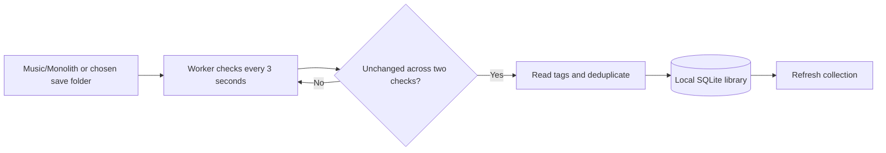

New copies normally appear after 3–6 seconds, once copying settles. Files added
while Monolith was closed are found after opening it. An unchanged file you
intentionally removed from the library stays removed across restarts; use manual
import to bring it back. Other folders remain available through the import picker.

If a saved song is unavailable, Monolith shows its saved path and offers **Locate
file**. Select that song's audio at its new location to reconnect the existing
entry and resume playback. Favorites and playlist memberships are kept. Invalid
files and files already assigned to another song are rejected before the saved
path changes. Cancelling keeps everything as it was. If the original audio was
deleted, restore it first; the library database does not contain a copy of it.

Reimporting a moved song also reconnects a unique matching entry automatically.
Filename, tags and duration must match; ambiguous recordings remain separate.
A database backup comes first, then favorites and playlist memberships are kept
on the original entry. Your audio files are never deleted or modified.

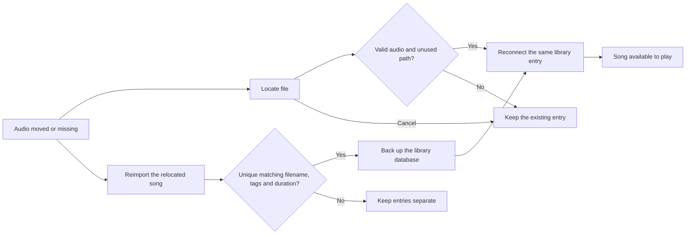

## Install

### Windows

Build `monolith-setup.exe` using the commands below, then run it. Setup lets you
choose a destination, shortcuts and whether to open the app afterwards. It installs
for the current user and registers an uninstaller; administrator rights are not
needed for the default location. An update preserves the library database.

```powershell
.\monolith-setup.exe /S --no-launch
```

This repository contains source, not executable build caches. A GitHub source
archive is not an installer. Release packages, when published, belong in Releases.

### Linux

The interface, playback worker and automatic imports share the same source as
Windows. Linux packaging supports a per-user install and a Debian package built
from a native Linux executable.

**Linux compilation and `.deb` installation are still unverified.** Windows media
keys/tray and acrylic do not imply Linux support for those features. See the
[Linux build and packaging guide](packaging/linux/README.md) for dependencies,
portal dialogs, package generation and platform differences.

### Optional download tools

Select your installed yt-dlp executable in Settings. YouTube extraction can also
require a supported JavaScript runtime and yt-dlp EJS support. MP3 conversion needs
FFmpeg on `PATH`. Tools are external and are not installed automatically. Save only
content you own or have permission to download.

## GitHub builds and updates

Settings now offers an explicit **Check for updates → Download → Open installer**
flow. Stable releases must match the exact platform/package, use the trusted
GitHub source, stay below 100 MB and provide a valid SHA-256 digest. Packages
are checked again before opening. Windows reuses the per-user installer; Linux
opens its `.deb` in the system package installer. Your library stays intact.
There are no embedded GitHub credentials or automatic downloads.

**This repository is intentionally private.** Anonymous in-app checks cannot
access its private releases, and the workflow below skips all jobs while private.
Public release distribution and the Linux build are on hold; the Windows app can
still be built and installed locally.

The [desktop workflow](.github/workflows/desktop-build.yml) builds the Windows
setup `.exe` and native Linux `.deb` on **standard public-repository runners**.
It refuses private-repository execution, uses no Actions cache/artifact storage,
and keeps generated build directories out of Git. Version tags attach only
final packages, platform-specific checksums and metadata to a **draft release**.
Review both jobs and publish that draft before the in-app updater can find it.
Main/PR runs are build checks and retain no installer artifacts.

Under [GitHub's current public-runner pricing](https://docs.github.com/en/billing/concepts/product-billing/github-actions),
this setup uses free execution. Release assets are distributed separately from
billable Actions storage. No paid runner, LFS, cloud relay or subscription is
required. This describes this workflow; it does not change account-wide billing
settings or other repositories.

### Nearby music sharing

**Windows 0.6.0:** use the Share icon in **Library** or **Songs**, then choose
**Monolith app** (same Wi-Fi/Ethernet) or **Bluetooth**. Select reveals row
checkboxes and a toolbar for sharing a batch, adding songs to playlists,
creating a populated playlist or removing entries after confirmation.
Current, selected and hovered songs use distinct colors in both themes.

Wi-Fi automatically discovers receiving Monolith devices and matches the
selected device's certificate internally over TLS 1.3. Choose a device; the
recipient accepts each song. No verification codes to copy. Bluetooth uses authenticated encrypted
RFCOMM pairing. Both reuse bounded offers, explicit approval, audio/SHA-256
validation, atomic no-overwrite saves and importer receipts. Share up to 100
songs, each up to 100 MB; each song has its own approval and receipt.
No account, cloud relay or paid service.
Sharing stays off at startup. Open Share to discover devices; Receive starts
the foreground listener. Close or Cancel closes its sharing sockets.
The Songs guide spotlights Share and Select in its third step. Discovery names
are local hints, not verified identities; use a trusted network.

Separate-device interoperability and the mobile bridge remain unverified.
This Windows machine has no Bluetooth radio. Linux shares the portable LAN
source/UI; native Linux/.deb execution and BlueZ/iPhone Bluetooth remain pending.
Read the [wire contract](docs/nearby-music.md), [JSON fixtures](docs/bluetooth-wire-fixtures.json)
and [mobile-agent prompt](docs/mobile-sharing-agent-prompt.md).


## Architecture

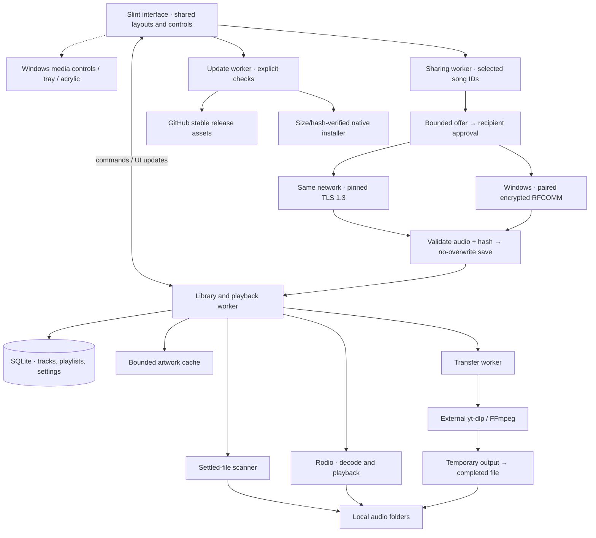

Filesystem work and metadata parsing run off the UI thread. Transfers use argument
arrays, bounded output handling, staging files and collision-safe publication.
Track thumbnails use the first valid embedded picture across the file's tags,
or a matching local JPG/JPEG/PNG/WebP sidecar. Artwork stays local; missing files
or missing covers show a music-note tile. Thumbnails are loaded on demand
and capped at 128 small decoded covers. Artwork decoding and caching are bounded. The Linux build uses desktop portal file
dialogs; Windows integration is conditionally compiled.

## Build and check

Requires a Rust toolchain compatible with the locked dependencies. Windows also
needs the Visual Studio C++ build tools and Windows SDK. Linux system packages are
listed in its [packaging guide](packaging/linux/README.md).

```sh
cargo build --release --locked --bin monolith-desktop
cargo test --release --locked --lib --bin monolith-desktop
cargo run --release --locked --example workflow_check
cargo run --release --locked --example transfer_check
cargo run --release --locked --example visual_check -- shot.ppm 1280 820 0 check
cargo run --release --locked --example guide_check -- shots/guide 420 380
```

`workflow_check` needs a display and audio device. `transfer_check` runs a fake
helper without network traffic. Add `--offline` once the dependencies are cached.

Build the Windows installer from PowerShell, reusing the player already built:

```powershell
$env:MONOLITH_PLAYER_EXE = (Resolve-Path target/release/monolith-desktop.exe).Path
cargo build --manifest-path installer/Cargo.toml --release --locked --offline
# installer/target/release/monolith-setup.exe
```

The installer also builds the player when the override is absent, using the main
`target` directory rather than creating a duplicate player cache.

### Storage and verification

Windows **0.6.0**, verified 2026-10-11: 39 release core tests, serial
all-target/format checks, source privacy audit and offline player/setup passed.
Four guide scenarios and installed native fixture checks cover title playback,
sharing choices, three-song selection, populated playlist creation, confirmed
removal and preserved original files. Socket checks verify sharing stays off
before Share and stops after Cancel/Close. Explicit Receive opens its foreground
listener. No copied verification code is required.

The installed player matches release bytes; existing library and local portrait
hashes are unchanged. Sharing process working set: 48.1 MiB; private: 11.8 MiB. This is a spot sample, not a transfer-peak measurement.
Player: **32,649,728 bytes**, SHA-256
`b2157425065f24bab66e4097f14b25dc05b804b113bec872f18bbcbff0a65f29`.
Setup: **48,299,008 bytes**, SHA-256
`3c2e61962c26d5ffa4d875f01e67d678b6288b50e42a4c7d81a51223fefad94d`.
Approved dependency downloads plus conservatively counted index files: ~8.9 MB.
Real-device Wi-Fi/Bluetooth, mobile bridges and native Linux remain pending.
Linux tool downloads already exceed the 100 MB cap; no Linux package was built.
Repository stays private, with no publication or paid workflow run.

Rust build caches are larger than shipped packages. `target/`,
`installer/target/`, `dist/` and local test captures stay outside Git. Retaining
Cargo dependencies and release caches avoids unnecessary downloads on the next
build. Disposable session fixtures and edit scripts were removed.

The playback memory target remains ≤130 MB including child processes; short
fixture samples do not establish peak usage. Earlier Windows checks cover local
artwork, folder imports, persistence, tray repaint, seek/volume fills, removal
warnings and moved-file recovery. Their historical evidence stays in local agent
notes rather than duplicating outdated package hashes here.

Physical DPI transitions, screen-reader announcements, large-library performance,
real download peaks and Linux runtime still need verification. See the examples
for executable checks rather than treating screenshots as full feature coverage.

On Windows, `python tools/check-guide-hover.py target/release/monolith-desktop.exe`
checks actual on-screen partial repaint during muted fixture playback. It walks
all 15 tour steps with solid and acrylic rendering, checks the card's action row,
and rejects unexpected changes outside the card. Python with Pillow is needed
only for this optional development check; test data and captures stay in `.work/`.

## One identity, two apps

| Desktop | Mobile |
| --- | --- |
| **This repository** · Rust + Slint, Windows verified; Linux build pending | **[Monolith](https://github.com/naveed-gung/Monolith)** · Flutter for Android and iOS |
| Local file paths and SQLite | Mobile imports, local storage and platform audio integration |

They share the Monolith visual identity, but have independent codebases and
libraries. Cross-device sync is not implemented.

## Project assets and licence

The developer credit uses public project attribution and the Monolith product
mark by default. A local `developer-photo.png` in the application-data folder
can replace that mark on this installation; the file stays outside Git and release
packages and survives updates. Missing, oversized or invalid PNGs fall back to
the product mark. Display obfuscation is not encryption. Private transcripts, credentials, personal library data and build
caches are not product source and must stay out of Git and release packages.

Proprietary licence — see [LICENSE](LICENSE). Built with [Slint](https://slint.dev),
[Rodio](https://github.com/RustAudio/rodio), [rusqlite](https://github.com/rusqlite/rusqlite)
and [Lofty](https://github.com/Serial-ATA/lofty-rs).
