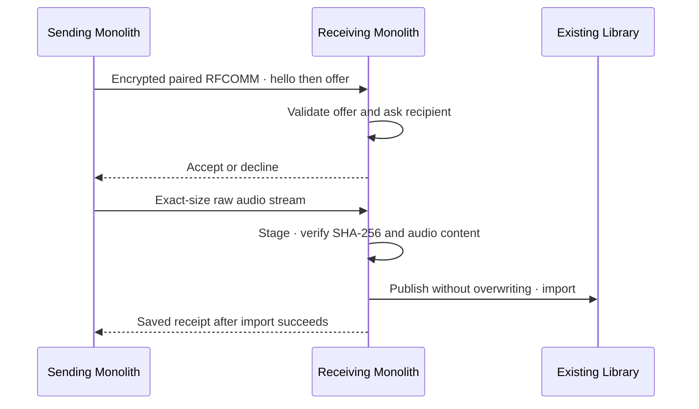

# Monolith Nearby — app and Bluetooth song sharing

Desktop 0.6.0 offers **Library/Songs → Share icon → Monolith app or Bluetooth**.
Settings no longer contains a sharing shortcut. **Select** reveals a checkbox
beside every visible song; row/title clicks select instead of starting playback.
Select all affects visible results only; existing hidden selections remain in
the count. Selection IDs survive filtering and sorting and clear when changing
tabs or finishing selection. The toolbar shares, adds to an existing playlist,
creates a populated playlist or removes entries. Library/playlist removal asks
first, defaults to Cancel and preserves original audio. Bulk database edits are
one transaction; stale IDs/invalid playlists fail without partial changes.

Share accepts up to **100 selected songs**, each at most **100,000,000 bytes**.
One song per connection retains the existing v1 wire contract. Every file is
preflighted before the first send. Each recipient approves each offer; completed
receipts are counted and errors report partial completion honestly. No resume.
Receive is an explicit five-minute foreground session supporting repeated
approved offers; Close/Cancel stops it and aborts active sockets. Hashing,
discovery, transfer and imports run off the UI thread.
Nothing advertises or opens sharing sockets at app startup. Discovery runs only
after opening Share and choosing Monolith app; a listener starts only on Receive.
Close/Cancel stops discovery and drops the receiving sockets. There is no
background sharing service, autostart listener or unattended acceptance.

## Monolith app over Wi-Fi / Ethernet

This transport is implemented in portable Rust, but only Windows execution and
loopback interoperability have been tested. Mobile needs the matching update.
Use the same IPv4 local network. Recipient chooses **Monolith app → Receive**.
Sender chooses **Monolith app**, selects the recipient's friendly session name
and sends. Nearby devices refresh automatically while the picker is open;
Refresh also rescans on demand. The recipient approves each song before saving.
There is no copy/paste verification code. Songs' third guide step highlights
Share and Select and explains both transports and sharing a selection.

Discovery is opt-in UDP broadcast to port **45881**, TTL 1. It announces no
hostname, account, song names or library; only a generated session alias and
public certificate fingerprint accompany the listening port. The query JSON is
`{"app":"monolith-music","version":1,"type":"discover","nonce":"<32 hex>"}`.
The receiving session replies to the query source with
`{"app":"monolith-music","version":1,"type":"available","nonce":"<same nonce>","port":<TCP port>,"alias":"Quiet Coral Cedar","fingerprint":"<64 hex>"}`.
The sender derives the IP from the datagram source, accepts only private,
link-local or loopback IPv4 addresses, bounds datagrams to 2048 bytes and caps
the list at 32 devices. A scan lasts two seconds and respects cancellation.
Discovery is unauthenticated: aliases identify picker choices, not verified
people or genuine binaries. Missing/malformed fingerprints, invalid aliases,
wrong nonces and other app IDs are rejected. Scans repeat after five seconds
without disabling controls or resetting song choices. Device selection uses a
stable address/certificate ID; reordering or disappearance cannot reroute Send.

The recipient listens on an ephemeral TCP port only while Receive is active.
Each receiving session generates an ephemeral P-256 key/self-signed X.509 cert.
The **64-hex-character fingerprint** is SHA-256 of the DER cert, supplied by
discovery and used internally. TLS **1.3 only**, Rustls with ring, matches that
selected endpoint's certificate and verifies its handshake signature before
song data. A changed certificate fails with a refresh explanation. No blanket
certificate bypass, cloud service, stored private key or repository token.
This pins the discovered endpoint; it does not independently authenticate a
person or protect discovery against an active attacker on an untrusted LAN.
Use a trusted local network and explicit recipient consent. The sender label
is generic rather than an authenticated account. The discover/select/approve
experience follows [LocalSend's protocol](https://github.com/localsend/protocol),
while the Monolith-only framed song protocol is **not HTTP or wire-compatible
LocalSend**. No LocalSend source was copied.

Sockets poll cancellation every 200 ms, cap idle waits at 75 seconds, connection
setup at three seconds and active connections at 15 minutes. TLS buffers are
bounded to 128 KiB. OS firewall prompts are user decisions; no firewall rules
are changed automatically. Client isolation/public networks may prevent discovery.

Rustls, ring and rcgen were explicitly approved. Optional AWS-LC/PEM/parser
features stay off. Streaming SHA-256 reuses ring for sharing and updates,
removing external PowerShell/sha256sum hashing subprocesses.

## Bluetooth

Pair devices in system settings, then choose **Bluetooth** on both apps. The
recipient starts Receive; the sender chooses a paired device and song/selection.
Paired names are local OS labels, not verified app identities. The connection
targets the Monolith UUID, followed by a version handshake. Windows has native
authenticated encrypted RFCOMM; this test machine has no radio. Real hardware
interoperability, Android bridge, Linux BlueZ and iPhone adapters remain pending.

## Bluetooth transport request

LocalSend inspired the offer/accept/transfer experience; its IP/HTTPS API is not
used here. No LocalSend source was copied. This is a distinct Monolith protocol.

Windows uses cached authenticated paired-device enumeration, `AF_BTH` RFCOMM,
`SO_BTH_AUTHENTICATE` and `SO_BTH_ENCRYPT`. Both security options must succeed;
there is no insecure fallback. The foreground receiver registers an SDP service
and removes it when stopped. UUID/service/hello are compatibility filters, not
proof of a genuine binary. Trust depends on OS pairing plus recipient consent.
Bluetooth audio output to headphones is separate from sharing song files.

Native API references: [Windows socket security](https://learn.microsoft.com/en-us/windows/win32/bluetooth/bluetooth-and-socket-options),
[Windows SDP service registration](https://learn.microsoft.com/en-us/windows/win32/bluetooth/bluetooth-and-wsaqueryset-for-set-service),
[Android secure RFCOMM](https://developer.android.com/develop/connectivity/bluetooth/connect-bluetooth-devices).
Linux BlueZ RFCOMM and iPhone Core Bluetooth/GATT require separate adapters and
real tests; the Windows RFCOMM implementation does not promise iPhone support.

## Wire contract v1

Service UUID: `e8793c34-7c2e-49ad-88c2-16c9a0762c91`.
JSON examples live in [the fixtures](bluetooth-wire-fixtures.json), enforced by
Rust tests. The fixture SHA-256 is illustrative, not a valid audio digest.

Every control record is **4-byte unsigned big-endian UTF-8 JSON byte length**,
then exactly that many JSON bytes. Length must be 1–16,384. Never assume a socket
read fills a header/body; accumulate until the exact length, EOF or cancellation.
JSON object key order has no significance. Protocol v1 hello has exactly the
three supplied fields; unsupported versions/apps/extra hello fields are rejected.

1. Sender sends `hello`; receiver validates and sends its identical `hello`.
2. Sender sends `offer` with `name`, `title`, integer `size` and lowercase SHA-256.
3. Receiver validates the offer and gets explicit consent. It sends `accept` only
   after checking the destination and creating a session-owned staging file.
   Otherwise it sends `decline` or closes on malformed input.
4. Only after `accept`, sender writes exactly `size` raw audio bytes. This binary
   payload has **no per-chunk header**. Desktop uses buffers up to 65,536 bytes.
5. Receiver checks SHA-256 and audio content, publishes without overwriting and
   imports into the existing library. Only then sends `saved` with the same hash.
6. Sender validates the receipt. EOF/timeout/errors/cancel never mean success.
   Cancel closes the connection; there is no resumable-session/token API in v1.

One song per connection; maximum 100,000,000 bytes, minimum one byte. Each socket
wait has a 75-second idle timeout (connect: 15 seconds); a connection expires
absolutely after 15 minutes. The single worker serializes offers. UUIDs, sizes
and SHA-256 travel locally; no account, cloud server, signing key or paid service.

## Storage and safety

Sender may select only a local library entry. A remote peer never selects a disk
path. `name` must be a portable audio basename, at most 180 UTF-8 bytes, with no
separators, control characters, leading dot, trailing space/dot, reserved Windows
device stem, colon, executable suffix or other forbidden Windows characters.
`title` is nonempty, at most 480 UTF-8 bytes, without control characters. Supported
extensions match the existing importer: MP3, M4A, AAC, FLAC, WAV, OGG, AIFF/AIF.
The receiver also probes actual audio content before publishing.

Temporary files live in the chosen download/music folder. Collision checks plus
atomic `persist_noclobber` preserve originals, including a race after acceptance.
Partial, cancelled, corrupt or non-audio staging files are removed on normal
unwind. A crash can leave a temporary file; no broad cleanup of unknown files is
performed. Verified published audio is retained if library import fails; no
success receipt is sent. A lost receipt may leave a successfully imported song,
so retry can report a filename collision rather than silently duplicate it.

Embedded metadata/artwork survive byte-for-byte. Separate sidecar images are not
sent in v1. All disk I/O, hashing, sockets and import run off the UI thread.
Progress uses actual streamed byte counts; 100% bytes still awaits verification
and library receipt. No downloader/FFmpeg execution is involved.

## Verification boundary

Software checks cover actual WAV bytes over local sockets, library import before
receipt, decline, cancellation, partial EOF, bad hashes, non-audio payloads,
filename collisions, import failures, metadata limits and native socket-wait
cancellation. These prove software behavior, not Bluetooth hardware compatibility.

Before advertising interoperability, test real Windows↔Windows and
Windows↔Android secure pairing, discovery/service connection, accept/decline,
cancel/close, collisions, corruption, received artwork, title-click playback,
and listener removal. Linux/iPhone need their native adapters first. Keep the
100 MB local dependency-download cap, private repository and zero-paid-action
boundary. Public GitHub CI stays disabled while the repo is private.
